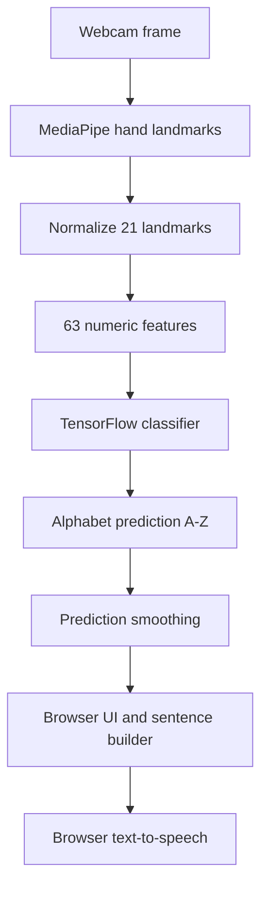
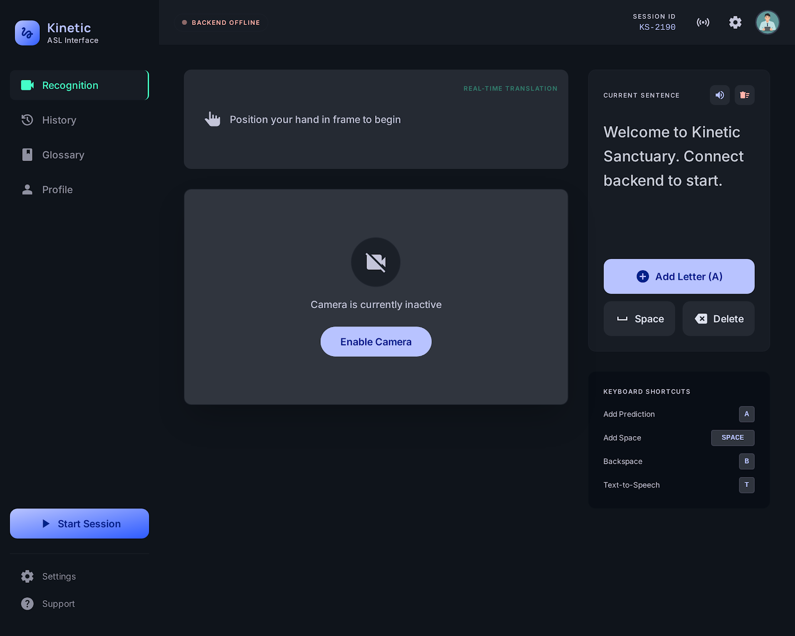
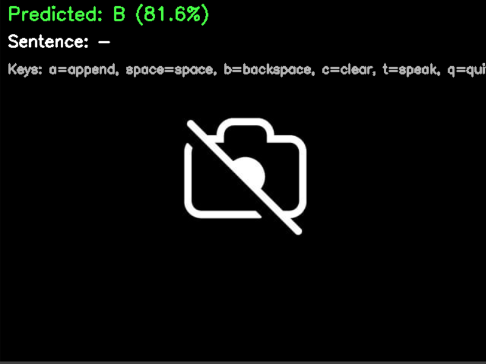

# ASL Vision — Real-Time Sign Language Alphabet Recognition

A computer-vision project that recognizes **static American Sign Language (ASL) alphabet hand shapes (A–Z)** using MediaPipe hand landmarks and a TensorFlow classifier. It includes a browser-based experience for real-time webcam predictions, plus a Python/FastAPI API and local inference tools.

<p align="center">
  <strong>Browser-based AI · Real-time hand tracking · Privacy-conscious inference</strong>
</p>

<p align="center">
  <a href="https://asl.themglabs.com/">Live Demo</a> ·
  <a href="https://github.com/017Mehul/asl-sign-language-recognition-ai/actions">GitHub Actions</a> ·
  <a href="#getting-started">Getting Started</a>
</p>

> **Scope and limitations:** This project classifies individual alphabet hand shapes. It is not a continuous sign-language translator and does not interpret complete signs, words, facial expressions, or ASL grammar. The letters **J** and **Z** involve motion and may not be reliably recognized from a single static hand pose. Recognition quality depends on the model, lighting, camera position, and hand visibility.

## Contents

- [Features](#features)
- [How it works](#how-it-works)
- [Demo and deployment](#demo-and-deployment)
- [Technology stack](#technology-stack)
- [Repository structure](#repository-structure)
- [Getting started](#getting-started)
- [Training a model](#training-a-model)
- [Testing](#testing)
- [API reference](#api-reference)
- [Privacy and security](#privacy-and-security)
- [Known limitations](#known-limitations)
- [License](#license)

## Features

- **A–Z alphabet classification** using 21 hand landmarks represented as 63 numeric features.
- **Live webcam experience** with MediaPipe Tasks Vision hand tracking in the browser.
- **Local browser inference** with TensorFlow.js; the static frontend does not need the FastAPI service to make predictions.
- **Prediction smoothing** to reduce rapid label changes between frames.
- **Sentence builder** with append-letter, space, delete, and clear actions.
- **Text-to-speech** through the browser's speech synthesis API.
- **Python inference and API** for local development and integrations.
- **Training pipeline and tests** to support model development and maintenance.

## How it works

1. **Capture:** The browser or local webcam script receives an image frame.
2. **Track:** MediaPipe detects a hand and returns 21 landmarks.
3. **Normalize:** Landmark coordinates are centered around the wrist and scaled into a 63-value feature vector.
4. **Classify:** A trained TensorFlow model predicts an alphabet class.
5. **Stabilize and display:** Browser predictions are smoothed over recent frames before a stable letter can be added to the sentence.

### Architecture



The browser frontend and Python backend are separate inference paths. The static website loads the TensorFlow.js model from `frontend/models/asl_tfjs/`; the Python API uses the original Keras model when available.

## Demo and deployment

**Live website:** [asl.themglabs.com](https://asl.themglabs.com/)

### Deploy the browser frontend to Vercel

The frontend is static HTML and JavaScript.

1. Import this repository into Vercel.
2. Set **Root Directory** to `frontend`.
3. Select the **Other** framework preset.
4. Leave the build command and output directory fields empty so Vercel serves the static files directly.
5. Confirm that `frontend/models/asl_tfjs/model.json` and its weight shard file(s) exist in the deployed revision.
6. Deploy, open the HTTPS URL, allow camera access, and test several different letters.

The model-conversion workflow can be run from **GitHub → Actions → Convert ASL model for browser**. Wait for the workflow to complete and verify the generated model files are committed before deploying a new model.

The first visit downloads TensorFlow.js/MediaPipe runtime assets and the hosted MediaPipe hand-landmarker task model. Webcam access requires HTTPS or localhost.

For the detailed frontend instructions, see [frontend/README.md](frontend/README.md).

### Screenshots

**Web interface**



**Local real-time inference**



## Technology stack

| Area | Technologies |
|---|---|
| Browser UI | HTML, CSS, JavaScript |
| Browser inference | TensorFlow.js |
| Hand tracking | MediaPipe Tasks Vision |
| Python API | FastAPI |
| ML framework | TensorFlow / Keras |
| Model features | 21 hand landmarks, 63 normalized coordinates |
| Deployment | Vercel for the static frontend |
| Automation and tests | GitHub Actions, Python unittest |

## Repository structure

```text
backend/app.py                 FastAPI application
data_collection/collect_data.py Dataset collection
inference/realtime_prediction.py Local webcam inference
training/train_model.py        Model training and evaluation
utils/feature_extraction.py    Shared landmark feature extraction
frontend/index.html            Static browser application
frontend/models/asl_tfjs/      TensorFlow.js model and weight shards
models/labels.json             Alphabet class order
models/asl_model.h5            Keras model artifact
tests/                         Automated tests
.github/workflows/             CI and model-conversion workflows
```

Dataset files and some generated training artifacts may need to be created locally; see [Training a model](#training-a-model).

## Getting started

### Requirements

- Python **3.10** for the pinned backend/training environment
- A webcam for live recognition
- Sufficient RAM and disk space for your selected training dataset
- HTTPS or localhost for browser camera access

The pinned TensorFlow 2.10 environment has platform and Python-version constraints. Do not assume it will install unchanged on Python 3.11+ or every operating system. The optional Windows DirectML plugin is not installed by the default requirements.

### Install

Clone the repository and create a virtual environment:

```bash
git clone https://github.com/017Mehul/asl-sign-language-recognition-ai.git
cd asl-sign-language-recognition-ai
python -m venv .venv
```

Activate it:

**Windows PowerShell**
```powershell
.\.venv\Scripts\Activate.ps1
```

**macOS / Linux**
```bash
source .venv/bin/activate
```

Install the dependencies:

```bash
python -m pip install --upgrade pip
pip install -r requirements.txt
```

### Run the API and web interface locally

From the repository root:

```bash
uvicorn backend.app:app --host 127.0.0.1 --port 8000
```

Then open:

- Web interface: [http://127.0.0.1:8000](http://127.0.0.1:8000)
- Interactive API docs: [http://127.0.0.1:8000/docs](http://127.0.0.1:8000/docs)
- Health check: [http://127.0.0.1:8000/health](http://127.0.0.1:8000/health)

A running server does not guarantee the model loaded successfully. Check the health response and confirm `model_ready: true` before expecting API predictions.

### Run local webcam inference

After a compatible model is available:

```bash
python inference/realtime_prediction.py
```

## Training a model

Training datasets are not included in the repository. Provide one of the following:

1. `dataset/landmarks.csv` with a `label` column and 63 numeric landmark feature columns; or
2. `dataset/asl_alphabet_images/<LABEL>/*`, with a directory per class containing images.

For image-based training, the pipeline extracts hand landmarks from images. Images where MediaPipe cannot detect a hand may be skipped. The default class set is A–Z, and the exact fitted class order is written to `models/labels.json`.

Run training:

```bash
python training/train_model.py --epochs 80 --batch_size 32
```

Expected generated artifacts include:

- `models/asl_model.h5` — trained classifier
- `models/labels.json` — output-neuron label order
- `models/training_metrics.json` — test metrics and per-class report
- `models/training_history.csv` — training history

The browser conversion workflow converts the Keras model to TensorFlow.js files under `frontend/models/asl_tfjs/`. The model JSON and corresponding binary weight shard(s) must be deployed together.

**Report only metrics produced by your own reproducible training run.** Accuracy depends on dataset quality, class balance, subject diversity, and evaluation methodology; this README does not claim a verified accuracy percentage.

## Testing

Install the requirements, then run:

```bash
python -m unittest discover -s tests -v
python -m compileall -q backend data_collection inference training utils tests
```

GitHub Actions runs the Python syntax checks and unit tests on Python 3.10. These checks do not establish real-world recognition accuracy; test the live camera flow separately with multiple users, lighting conditions, and hand positions.

## API reference

The FastAPI application exposes these routes:

| Method | Endpoint | Purpose |
|---|---|---|
| `GET` | `/` | Browser interface |
| `GET` | `/health` | Service and model readiness |
| `POST` | `/predict` | Predict from a base64 image or data URL |
| `GET` | `/sentence/{session_id}` | Retrieve the current in-memory sentence |
| `POST` | `/sentence/action` | Append, space, backspace, clear, or speak |

Interactive schemas are available at `/docs` when the API is running.

For cross-origin browser clients, configure `ASL_ALLOWED_ORIGINS` with a comma-separated list of trusted origins. For example:

```text
ASL_ALLOWED_ORIGINS=https://your-frontend.example
ASL_MIN_CONFIDENCE=0.60
```

The default allowed origins are localhost development addresses. A frontend served by the same FastAPI application does not need CORS for same-origin requests.

Sentence state in the API is stored in process memory and resets when the process restarts. It is not durable or shared across multiple workers. Server-side text-to-speech also depends on the host's audio capabilities; the static frontend instead uses browser speech synthesis.

## Privacy and security

- The static frontend performs image inference in the browser; it does not send webcam frames to the FastAPI backend for predictions.
- The browser stores the sentence in local storage on that device. Clear browser storage to remove it.
- The first visit downloads third-party runtime assets and the MediaPipe hand-landmarker model from their hosting services.
- Use HTTPS for public deployments and restrict `ASL_ALLOWED_ORIGINS` to trusted origins when using the API.
- Do not commit private datasets, secrets, or credentials.
- Confirm model readiness before relying on API inference.
- The project is an educational accessibility prototype, not a substitute for a qualified interpreter.

## Known limitations

- The model predicts alphabet classes from hand landmarks, not full sign-language meaning or grammar.
- Motion-based letters such as J and Z may be less reliable with a static-pose classifier.
- Performance may vary with lighting, camera angle, occlusion, and differences between training and real-world hands.
- Browser and Python MediaPipe runtimes may produce different landmarks; validate the deployed model using a real webcam.
- Model performance claims should be backed by documented test data and reproducible evaluation.

## License

Distributed under the [MIT License](LICENSE).

## Author

**Mehul Gupta**
